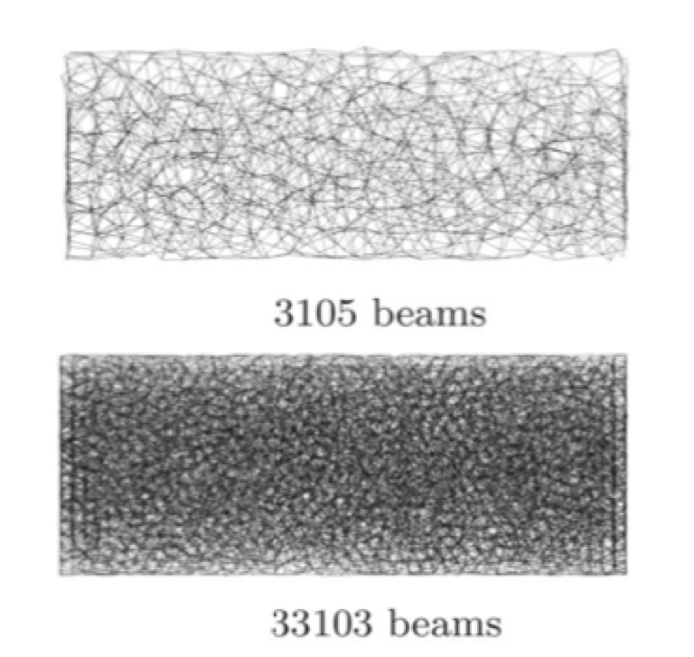
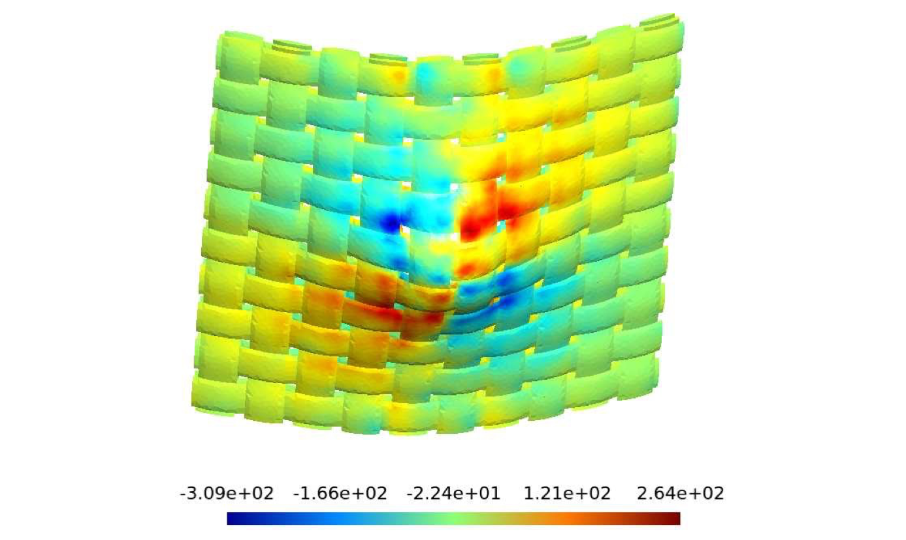
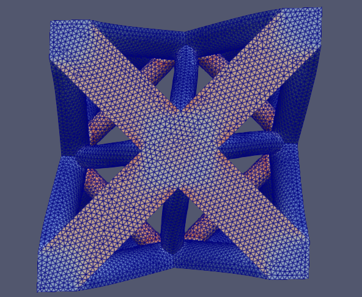

# fedoo — Nonlinear Finite Element Analysis in Python

<div class="feature feature--left">

<div class="feature__body"><p class="feature__excerpt">fedoo is a Python Finite Element library, highly tunable with emphasis on model reduction (PGD, AI-based models). It balances speed and ease-of-use, and integrates a non-linear solver with tools to facilitate homogenization techniques and multiscale modelling.</p>
<p><a class="md-button md-button--primary" href="https://3mah.github.io/fedoo-docs/stable/">View Documentation</a></p></div>
</div>

Here are the main features:

* Entirely written in Python 3 with an emphasis on readable, maintainable code
* Implicit Finite Element solver for static and dynamic problems
* Resolution of problems based on separated decomposition (PGD, POD, Reduced bases)
* Integration with the simcoon library for finite strain constitutive laws
* Supports 2D, 3D, beam, plate, and cohesive elements
* Contact analysis in 2D and 3D, including self-contact
* Geometric non-linearities
* Periodic boundary conditions and automatic tangent matrix extraction for homogenization
* Multi-point constraint support for complex boundary conditions
* Embedded results visualization using the PyVista library
* Mesh import/export from msh (GMSH) and vtk formats
* Export results in vtk format for easy visualisation with [Paraview](https://www.paraview.org/)

## Install

=== "conda"

    ```bash
    conda install -c conda-forge -c set3mah fedoo
    ```

=== "pip"

    ```bash
    pip install "fedoo[all]"
    ```

## Documentation

<div class="doc-links" markdown>
[:octicons-download-16: Installation](https://3mah.github.io/fedoo-docs/stable/install.html){ .md-button }
[:octicons-rocket-16: Quick start](https://3mah.github.io/fedoo-docs/stable/quick_start.html){ .md-button }
[:octicons-book-16: User guide](https://3mah.github.io/fedoo-docs/stable/overview.html){ .md-button }
[:octicons-image-16: Examples](https://3mah.github.io/fedoo-docs/stable/examples/index.html){ .md-button }
</div>

## Featured examples

--8<-- "examples_fedoo.md"

[:octicons-image-16: All examples of the 3MAH stack](examples.md){ .md-button .md-button--primary }
[:octicons-arrow-left-16: Back to 3MAH](index.md){ .md-button }

## Research highlights

<figure class="gallery gallery--3">
<a href="/assets/images/about/fedooBeams.png"></a>
<a href="/assets/images/about/sigxyyarns.png"></a>
<a href="/assets/images/about/shearPerio.png"></a>
<figcaption>Examples of Finite Element simulations using fedoo: <code>Beam network</code>, <code>damage in composites</code>, and <code>architectured materials</code>.</figcaption>
</figure>
