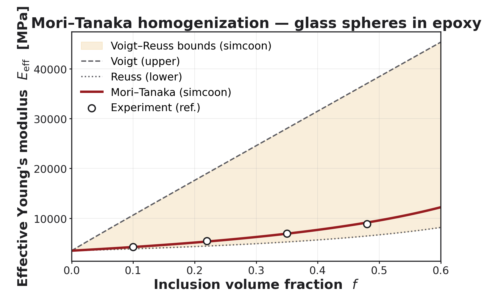
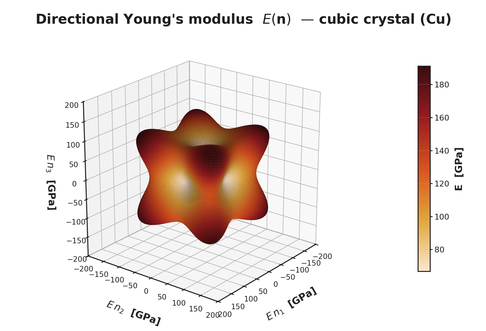
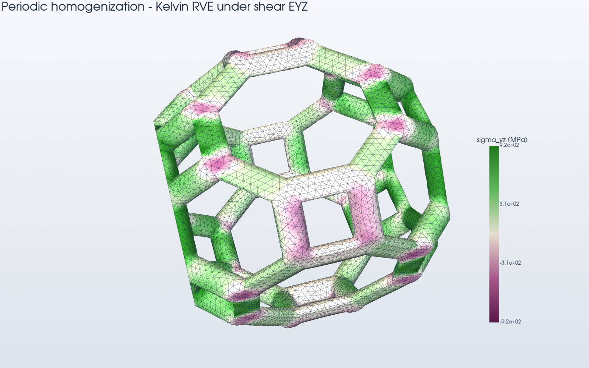
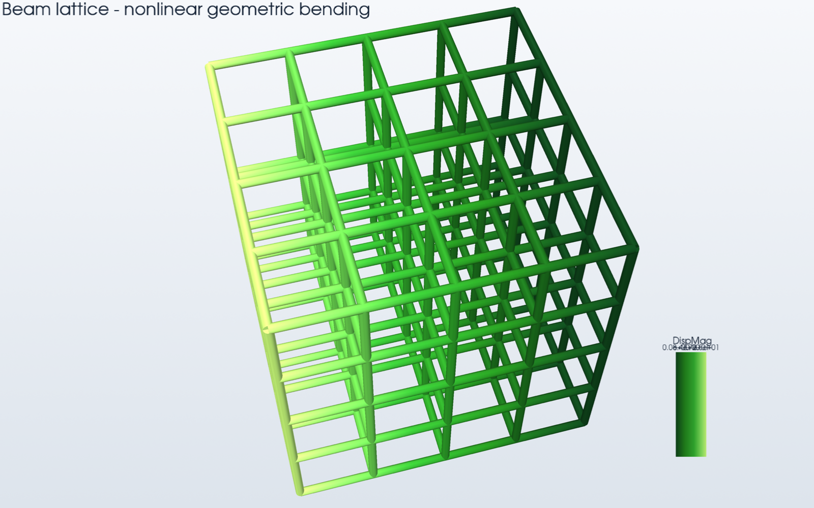
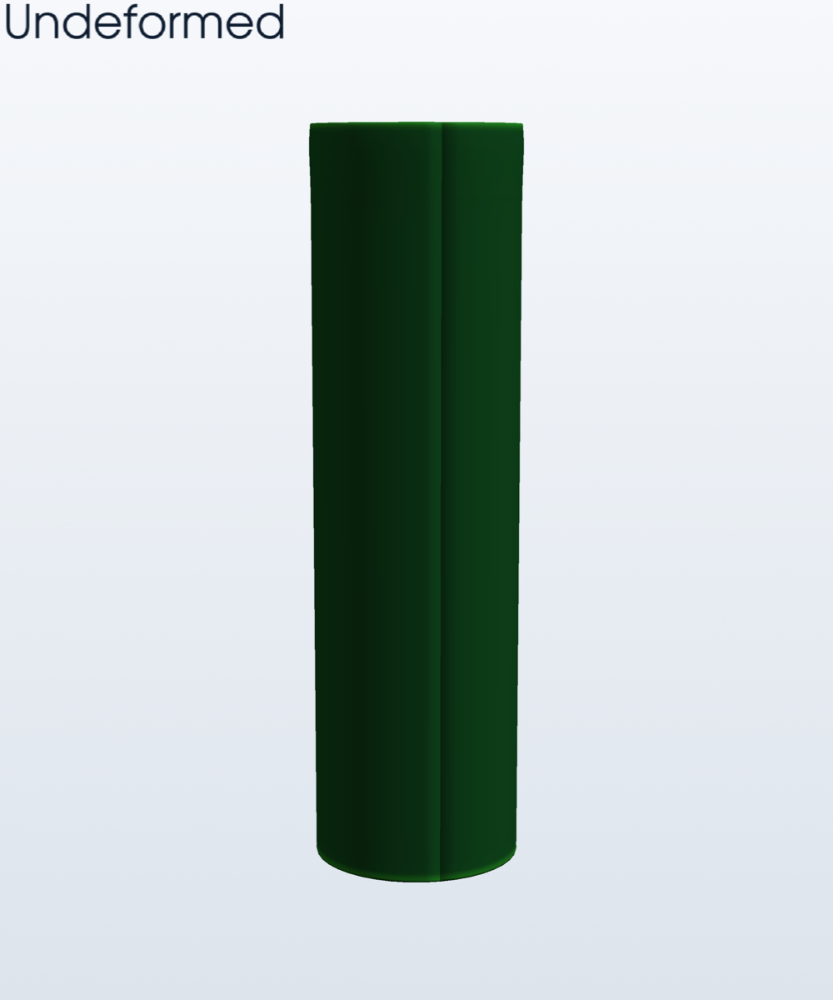
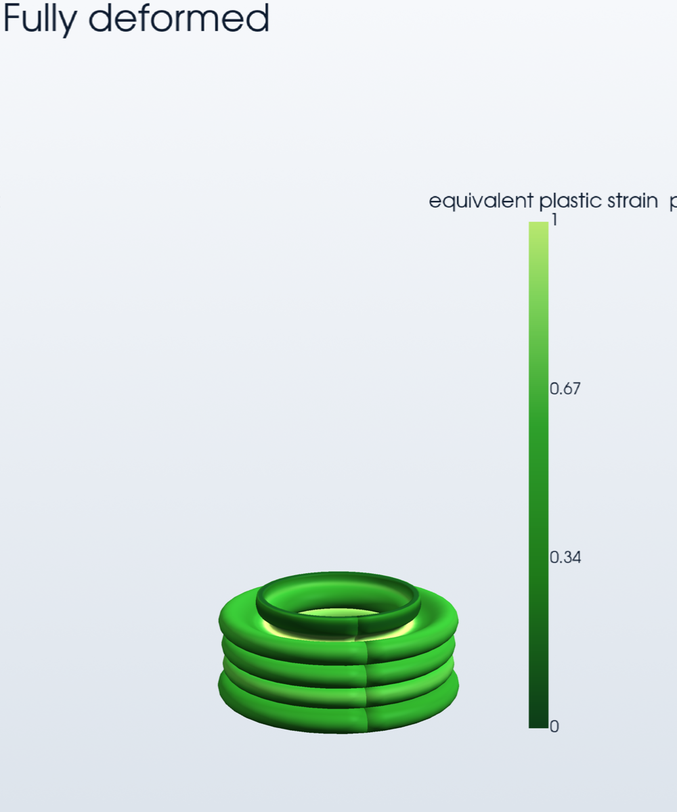
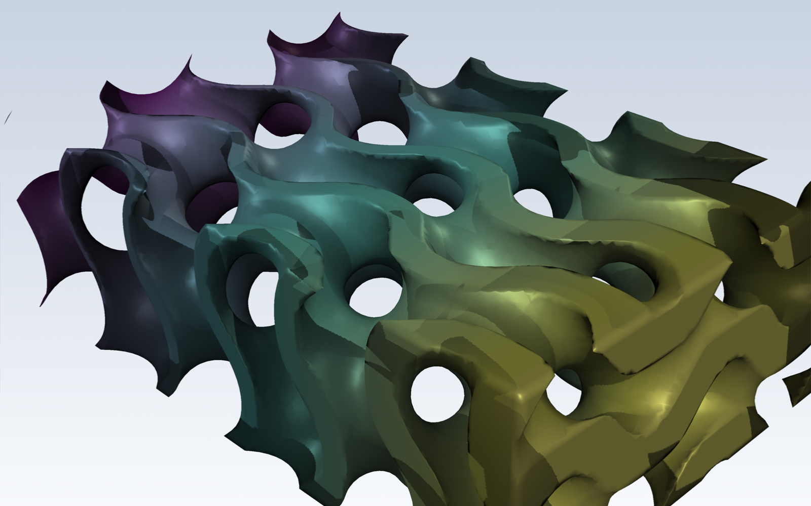
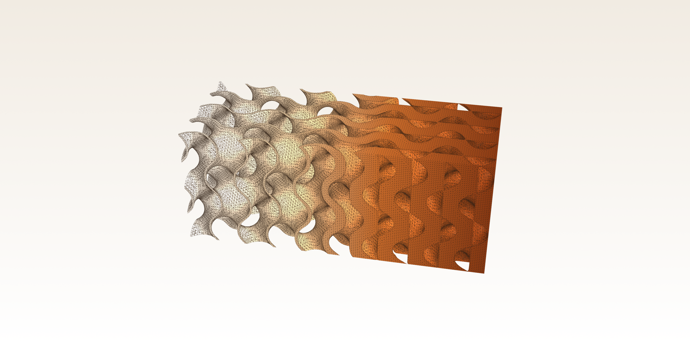

<div class="feature-lead">
<p>The <strong>3MAH</strong> initiative brings together three complementary, interoperable open-source libraries: <strong>simcoon</strong> for constitutive modeling and micromechanics, <strong>fedoo</strong> for nonlinear finite element analysis, and <strong>microgen</strong> for microstructure generation and meshing. Together, they provide a complete pipeline from geometry to simulation for research in mechanics of heterogeneous and architectured materials.</p>
</div>

## From microstructure to simulation

An elasto-plastic gyroid under periodic homogenization: microgen generates the unit cell and its periodic mesh, remeshed with mmg, simcoon supplies the plasticity law, fedoo applies a 2 % mean tensile strain. simcoon tensors then post-process the result: the macroscopic stress, and the tangent modulus of the cell, inverted to get the strain increment of a uniaxial stress increment, Δε = L<sub>t</sub><sup>-1</sup> : Δσ.

??? example "Show the Python script and its output"

    ```python
    import fedoo as fd
    import numpy as np
    import pyvista as pv
    import simcoon as sim
    from microgen import Phase, Rve, Tpms, mesh_periodic
    from microgen.remesh import remesh_keeping_boundaries_for_fem
    from microgen.shape.surface_functions import gyroid

    # microgen: a gyroid unit cell, meshed with matching nodes on opposite faces,
    # then remeshed with mmg for well-shaped tetrahedra
    cell = Phase.from_cad(Tpms(surface_function=gyroid, density=0.3, resolution=30).generate_cad())
    cell.cad.export_step("gyroid.step")
    mesh_periodic(
        mesh_file="gyroid.step",
        rve=Rve(dim=1),
        list_phases=[cell],
        size=0.035,
        order=1,
        output_file="gyroid.vtk",
    )
    remesh_keeping_boundaries_for_fem(
        pv.UnstructuredGrid("gyroid.vtk"), periodic=True, hmax=0.035
    ).save("gyroid.vtk")

    # simcoon: elasto-plastic law with isotropic power-law hardening
    #                 E      nu   alpha  sigma_y  k     m
    props = np.array([200e3, 0.3, 1e-5, 300.0, 1000.0, 0.3])
    material = fd.constitutivelaw.Simcoon("EPICP", props)

    # fedoo: periodic homogenization of the cell under a 2 % mean tensile strain
    fd.ModelingSpace("3D")
    mesh = fd.Mesh.read("gyroid.vtk")
    assembly = fd.Assembly.create(fd.weakform.StressEquilibrium(material), mesh)

    pb = fd.problem.NonLinear(assembly)
    pb.bc.add(fd.constraint.PeriodicBC("small_strain"))
    pb.bc.add("Dirichlet", mesh.nearest_node(mesh.bounding_box.center), "Disp", 0)
    pb.bc.add("Dirichlet", "E_xx", 0.02)
    pb.nlsolve(dt=0.025, tmax=1)

    # simcoon tensors: macroscopic stress at the end of the loading
    volume = mesh.bounding_box.volume
    sigma = sim.Tensor2.stress(pb.get_ext_forces("MeanStrain").ravel() / volume)
    print(f"macroscopic von Mises stress: {sigma.mises():.1f} MPa")

    # tangent modulus of the cell, then the strain increment of a uniaxial
    # stress increment: deps = Lt^-1 : dsig
    Lt = sim.Tensor4.stiffness(fd.homogen.get_tangent_stiffness(pb))
    dsig = sim.Tensor2.stress([10, 0, 0, 0, 0, 0])
    deps = Lt.inverse() @ dsig
    print("strain increment (%):", (100 * deps.voigt).round(2))
    print(f"uniaxial tangent modulus: {dsig.voigt[0] / deps.voigt[0]:.0f} MPa")

    pb.get_results(assembly, ["Stress", "P"]).plot("P")
    ```

    The script prints:

    ```text
    macroscopic von Mises stress: 92.3 MPa
    strain increment (%): [ 1.07 -0.4  -0.4   0.    0.   -0.  ]
    uniaxial tangent modulus: 938 MPa
    ```

<figure class="showcase showcase--fedoo">
  <p class="showcase__title">A full simulation framework</p>
  <div class="showcase__grid showcase__grid--cols-3">
    <figure class="showcase__cell">
      
      <p class="showcase__subcaption"><strong>microgen</strong> — periodic mesh of the gyroid cell after mmg remeshing, 30 % density.</p>
    </figure>
    <figure class="showcase__cell">
      
      <p class="showcase__subcaption"><strong>fedoo</strong> — equivalent plastic strain at 2 % mean strain along x (dark to light: 0 to 2.5 %).</p>
    </figure>
    <figure class="showcase__cell">
      
      <p class="showcase__subcaption"><strong>simcoon</strong> — macroscopic response and tangent modulus L<sub>t</sub> at the end of the loading.</p>
    </figure>
  </div>
</figure>

At 2 % mean strain the cell carries 92 MPa, for a matrix that yields at 300 MPa. A further uniaxial stress increment of 10 MPa along x stretches the cell by 1.07 % and contracts it by 0.40 % in the two transverse directions: the tangent modulus of the cell has dropped to 0.94 GPa. The mesh has about 27 400 nodes; the images are produced with the same parameters by `scripts/render_libraries.py`.

<p><a class="md-button md-button--primary" href="/libraries/">The three libraries</a> <a class="md-button" href="/get-started/">Install them</a></p>

## simcoon — Constitutive modeling & micromechanics { .brand-simcoon }

<div class="feature-grid feature-grid--3">
<div class="feature">

<div class="feature__body"><p class="feature__title">simcoon</p>
<p class="feature__excerpt"><strong>Constitutive modeling and micromechanics</strong> in C++ with Python bindings. Anisotropic elasticity, plasticity (isotropic, kinematic, Chaboche), viscoelasticity, hyperelasticity and phase transformation, with finite-strain support.</p>
<p><a class="md-button md-button--primary" href="https://3mah.github.io/simcoon-docs/">simcoon docs</a></p></div>
</div>
<div class="feature">

<div class="feature__body"><p class="feature__title">Mean-field homogenization</p>
<p class="feature__excerpt">Effective properties of composites with <strong>Mori-Tanaka</strong> and self-consistent schemes, framed by Voigt and Reuss bounds and validated against experimental data.</p>
<p><a class="md-button md-button--primary" href="https://3mah.github.io/simcoon-docs/examples/heterogeneous/homogenization.html">See example</a></p></div>
</div>
<div class="feature">

<div class="feature__body"><p class="feature__title">Analysis &amp; identification</p>
<p class="feature__excerpt">Analyse <strong>directional stiffness</strong>, yield surfaces and cyclic response, then identify model parameters with hybrid genetic-gradient algorithms.</p>
<p><a class="md-button md-button--primary" href="https://3mah.github.io/simcoon-docs/examples/analysis/directional_stiffness.html">See example</a></p></div>
</div>
</div>

<figure class="showcase showcase--simcoon">
  <p class="showcase__title">Parameter identification from cyclic experiments</p>
  <p class="showcase__lede">
    Identify <strong>seven Chaboche parameters</strong> — initial yield σ_y,
    Voce isotropic hardening (Q, b) and two non-linear Armstrong-Frederick
    backstresses (C₁, D₁, C₂, D₂) — from <strong>three cyclic uniaxial
    tests</strong> at increasing strain amplitudes. simcoon's
    <strong>EPCHA</strong> UMAT is the forward model, driven through
    <code>sim.solver</code>; the new <code>simcoon.identify</code> module
    wraps SciPy's differential evolution with a key-based file-templating
    workflow that generalises to any optimiser or external simulator.
  </p>
  <video class="showcase__video"
         src="/assets/images/index/simcoon/simcoon_chaboche_identification.mp4"
         poster="/assets/images/index/simcoon/simcoon_chaboche_identification.png"
         autoplay loop muted playsinline preload="metadata"
         aria-label="Differential-evolution iterations converging onto three experimental cyclic stress-strain curves"></video>
  <p class="showcase__caption">
    EPCHA UMAT · E = 140 GPa, ν = 0.3 (fixed) · 7 parameters identified ·
    cost = NMSE-per-response, balanced across the three tests · optimiser:
    <code>scipy.optimize.differential_evolution</code> (popsize 15, maxiter 80,
    seed 42) · final cost ≈ 8 × 10⁻³.
  </p>
</figure>

## fedoo — Nonlinear finite element analysis { .brand-fedoo }

<div class="feature-grid feature-grid--3">
<div class="feature">

<div class="feature__body"><p class="feature__title">fedoo</p>
<p class="feature__excerpt">A <strong>Python finite element solver</strong> for nonlinear mechanics, with an emphasis on geometric and material nonlinearity, model reduction (PGD) and multiscale homogenization.</p>
<p><a class="md-button md-button--primary" href="https://3mah.github.io/fedoo-docs/stable/">fedoo docs</a></p></div>
</div>
<div class="feature">

<div class="feature__body"><p class="feature__title">Periodic homogenization</p>
<p class="feature__excerpt">Apply <strong>periodic boundary conditions</strong> on representative volume elements to extract full anisotropic effective stiffness and nonlinear macroscopic response.</p>
<p class="feature__scale feature__scale--fedoo-div" aria-label="Colour scale: shear stress from -920 to +920 MPa"><span>&minus;920</span><i></i><span>+920 MPa</span><span class="feature__scale-name">shear stress &sigma;<sub>yz</sub></span></p>
<p><a class="md-button md-button--primary" href="https://3mah.github.io/fedoo-docs/stable/examples/boundary_conditions/periodic_bc_3d_gyroid_off_axis.html">See example</a></p></div>
</div>
<div class="feature">

<div class="feature__body"><p class="feature__title">Beam, shell and solid elements</p>
<p class="feature__excerpt">From 2D plates with holes to 3D <strong>beam lattices</strong> and pressurised shells: a unified API for 1D, 2D and 3D structural analysis.</p>
<p class="feature__scale feature__scale--fedoo-seq" aria-label="Colour scale: displacement magnitude from 0 to 25, for a lattice of side 100"><span>0</span><i></i><span>25</span><span class="feature__scale-name">displacement |u| (lattice side: 100)</span></p>
<p><a class="md-button md-button--primary" href="https://3mah.github.io/fedoo-docs/stable/examples/basic/lattice_beam.html">Read more</a></p></div>
</div>
</div>

<figure class="showcase showcase--fedoo">
  <p class="showcase__title">Nonlinear and finite-strain mechanics</p>
  <p class="showcase__lede">
    Plastic buckling of a thin tube under axial compression — 2D <strong>axisymmetric</strong>
    model with <strong>updated-Lagrangian</strong> finite strain,
    <strong>self-contact</strong>, and a simcoon <strong>EPICP</strong>
    elasto-plastic UMAT. Line-search Newton with adaptive stiffness drives
    the tube from undeformed to fully folded in a single nonlinear solve.
  </p>
  <div class="showcase__grid showcase__grid--cols-3">
    <figure class="showcase__cell">
      
      <p class="showcase__subcaption"><strong>Initial</strong></p>
    </figure>
    <figure class="showcase__cell">
      <video class="showcase__video"
             src="/assets/images/index/fedoo/fedoo_tube_evolution.mp4"
             poster="/assets/images/index/fedoo/fedoo_tube_initial.png"
             autoplay loop muted playsinline preload="metadata"
             aria-label="Tube buckling evolution from undeformed to fully folded under axial compression"></video>
      <p class="showcase__subcaption"><strong>Evolution</strong></p>
    </figure>
    <figure class="showcase__cell">
      <a href="https://3mah.github.io/fedoo-docs/stable/examples/contact/tube_compression.html">
        
      </a>
      <p class="showcase__subcaption"><strong>Final</strong></p>
    </figure>
  </div>
  <p class="showcase__caption">
    E = 200 GPa · σ_y = 300 MPa · power-law isotropic hardening
    <code>σ = σ_y + k·p<sup>m</sup></code> (k = 1000, m = 0.3) ·
    240 axial elements · 3D revolution from the axisymmetric solution ·
    field shown: equivalent plastic strain p.
  </p>
</figure>

<div class="feature feature--left">
<video class="feature__media" src="/assets/images/index/fedoo/fedoo_ipc_indentation.mp4" poster="/assets/images/index/fedoo/fedoo_ipc_indentation.png" autoplay loop muted playsinline preload="metadata" aria-label="Stiff disk progressively indenting a soft plate, von Mises stress field"></video>
<div class="feature__body"><p class="feature__title">Contact with IPC</p>
<p class="feature__excerpt">Robust <strong>incremental potential contact</strong> (IPC) via the <code>ipctk</code> backend — barrier-method, intersection-free, <strong>frictional or frictionless</strong> contact for indentation, self-contact and lattice compression. The disk-on-plate example here is validated against the Hertzian half-space solution.</p>
<p><a class="md-button md-button--primary" href="https://3mah.github.io/fedoo-docs/stable/examples/contact/ipc_indentation_2d.html">Read more</a></p></div>
</div>

## microgen — Microstructure generation & meshing { .brand-microgen }

<div class="feature-grid feature-grid--3">
<div class="feature">

<div class="feature__body"><p class="feature__title">microgen</p>
<p class="feature__excerpt">A <strong>Python library for microstructure generation and meshing</strong>: TPMS, lattices, polycrystals and hybrid architectures, exported to CAD or directly to periodic FE meshes.</p>
<p><a class="md-button md-button--primary" href="https://3mah.github.io/microgen-docs/">microgen docs</a></p></div>
</div>
<div class="feature">

<div class="feature__body"><p class="feature__title">Graded TPMS &amp; lattices</p>
<p class="feature__excerpt">Generate <strong>gyroids, Schwarz, Schoen</strong> and other triply periodic minimal surfaces, with spatially graded thickness and mapping onto arbitrary CAD bodies.</p>
<p><a class="md-button md-button--primary" href="https://3mah.github.io/microgen-docs/examples/TPMS/graded_density.html">See example</a></p></div>
</div>
<div class="feature">
<video class="feature__media" src="/assets/images/index/microgen/examples/voronoi_polycrystal.mp4" poster="/assets/images/index/microgen/examples/voronoi_polycrystal.png" autoplay loop muted playsinline preload="metadata" aria-label="Voronoi polycrystal grains assembling one by one"></video>
<div class="feature__body"><p class="feature__title">Polycrystals &amp; architectured cells</p>
<p class="feature__excerpt"><strong>Voronoi</strong> polycrystals, octet-truss lattices, honeycombs and hybrid architectures, ready for periodic homogenization in fedoo or Abaqus.</p>
<p><a class="md-button md-button--primary" href="https://3mah.github.io/microgen-docs/examples/3Doperations/voronoi.html">See example</a></p></div>
</div>
</div>

<figure class="showcase showcase--microgen">
  <p class="showcase__title">Graded and periodic meshes</p>
  <p class="showcase__lede">
    microgen drives <strong>Gmsh</strong> and <strong>MMG</strong> from
    Python to deliver two complementary mesh styles for architectured
    materials: <strong>graded</strong> structures with spatially varying
    thickness, and seamlessly <strong>periodic</strong> unit cells ready
    for periodic-homogenisation BCs in fedoo or Abaqus.
  </p>
  <div class="showcase__grid">
    <figure class="showcase__cell">
      <a href="https://3mah.github.io/microgen-docs/examples/TPMS/tpms_surfaces.html">
        
      </a>
      <p class="showcase__subcaption">
        <strong>Graded</strong> — tanh-graded gyroid, thickness varying along x.
      </p>
    </figure>
    <figure class="showcase__cell">
      <a href="https://3mah.github.io/microgen-docs/examples/Mesh/periodic_gyroid_remesh.html">
        
      </a>
      <p class="showcase__subcaption">
        <strong>Periodic</strong> — unit cell tiled 3 × 2, no seam visible.
      </p>
    </figure>
  </div>
  <p class="showcase__caption">
    Open CASCADE (OCP) for geometry · Gmsh for the conforming
    triangulation · MMG for adaptive remeshing · exported as <code>.vtk</code>
    /<code>.msh</code> for fedoo, Abaqus and others.
  </p>
</figure>

<div class="feature feature--right">
<video class="feature__media" src="/assets/images/index/microgen/microgen_morph.mp4" autoplay loop muted playsinline preload="metadata" aria-label="Continuous morphing through eleven TPMS surface families"></video>
<div class="feature__body"><p class="feature__title">Continuous morphing between TPMS families</p>
<p class="feature__excerpt">Blend any two TPMS surface functions with a tanh weight to walk continuously through families: <strong>gyroid → Schwarz P → Schwarz D → Neovius → Schoen IWP → Schoen FRD → Fischer-Koch S → PMY → honeycomb → Lidinoid → split P → gyroid</strong>. The animated transition exposes the underlying surface-function arithmetic of microgen.</p>
<p><a class="md-button md-button--primary" href="https://3mah.github.io/microgen-docs/examples/TPMS/graded_cell_type.html">See example</a></p></div>
</div>

<div class="feature-grid feature-grid--2">
<div class="feature">
<div class="feature__body"><p class="feature__title">Team</p>
<p class="feature__excerpt">Meet the researchers and labs behind 3MAH.</p>
<p><a class="md-button" href="/team/">About the team</a></p></div>
</div>
<div class="feature">
<div class="feature__body"><p class="feature__title">Gallery</p>
<p class="feature__excerpt">Explore simulations and renderings produced with the 3MAH stack.</p>
<p><a class="md-button" href="/gallery/">Open gallery</a></p></div>
</div>
</div>
