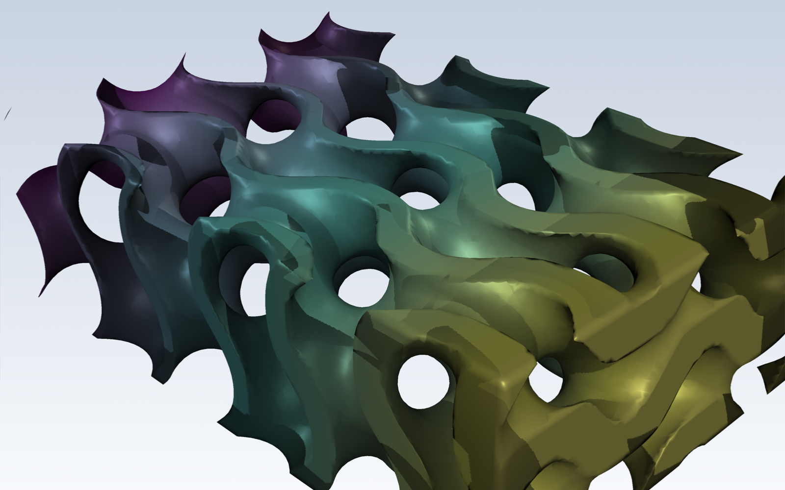
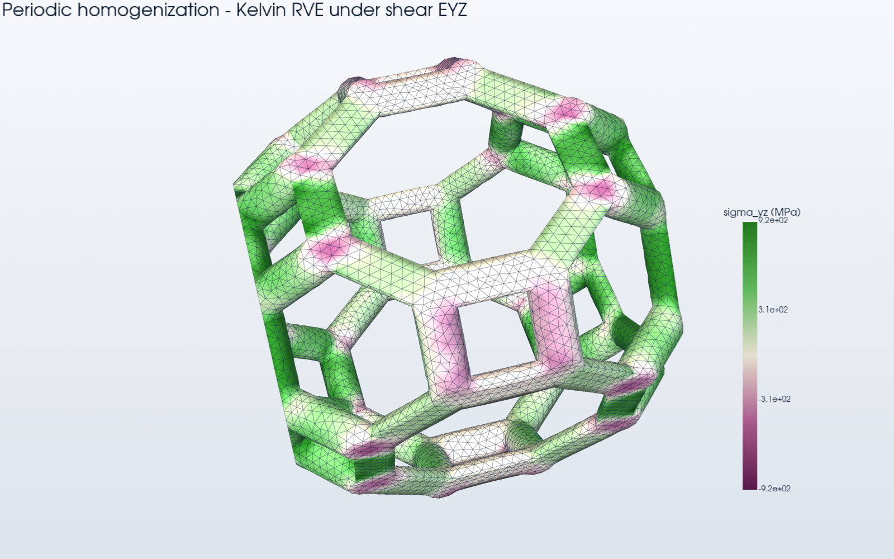

# Three libraries, one workflow

<div class="feature-lead">
<p>Each library is an independent Python package, and they are designed to be chained: <strong>microgen</strong> builds and meshes the microstructure, <strong>fedoo</strong> solves the finite element problem on that mesh, and <strong>simcoon</strong> provides the material behaviour at every integration point.</p>
</div>

<div class="feature-grid feature-grid--3">
<div class="feature">
<a href="../microgen/"></a>
<div class="feature__body">
<p class="feature__title">1 · Geometry and mesh</p>
<p class="feature__excerpt">TPMS, lattices, Voronoi polycrystals and hybrid architectures, built from implicit fields and exported as <strong>conforming periodic meshes</strong>.</p>
<p><a class="md-button md-button--primary" href="../microgen/">microgen</a> <a class="md-button" href="https://3mah.github.io/microgen-docs/">Docs</a></p></div>
</div>
<div class="feature">
<a href="../fedoo/"></a>
<div class="feature__body">
<p class="feature__title">2 · Finite element analysis</p>
<p class="feature__excerpt">A Python solver for <strong>nonlinear mechanics</strong>: finite strain, contact, periodic boundary conditions and homogenization, model reduction.</p>
<p><a class="md-button md-button--primary" href="../fedoo/">fedoo</a> <a class="md-button" href="https://3mah.github.io/fedoo-docs/stable/">Docs</a></p></div>
</div>
<div class="feature">
<a href="../simcoon/"></a>
<div class="feature__body">
<p class="feature__title">3 · Material behaviour</p>
<p class="feature__excerpt"><strong>Constitutive laws and micromechanics</strong> in C++ with Python bindings: elasticity, plasticity, viscoelasticity, hyperelasticity, phase transformation.</p>
<p><a class="md-button md-button--primary" href="../simcoon/">simcoon</a> <a class="md-button" href="https://3mah.github.io/simcoon-docs/">Docs</a></p></div>
</div>
</div>

## One script, three imports

A Kelvin cell (truncated octahedron lattice) and its elastic anisotropy: microgen generates the cell and its periodic mesh, remeshed with mmg, fedoo computes the effective stiffness by periodic homogenization, and simcoon tensors give the symmetry class, the elastic constants and the directional Young's modulus.

??? example "Show the Python script and its output"

    ```python
    import fedoo as fd
    import numpy as np
    import pyvista as pv
    import simcoon as sim
    from microgen import Phase, Rve, TruncatedOctahedron, mesh_periodic
    from microgen.remesh import remesh_keeping_boundaries_for_fem

    # microgen: a Kelvin cell, meshed with matching nodes on opposite faces,
    # then remeshed with mmg for well-shaped tetrahedra
    cell = Phase.from_cad(TruncatedOctahedron(strut_radius=0.08).generate_cad())
    cell.cad.export_step("kelvin.step")
    mesh_periodic(
        mesh_file="kelvin.step",
        rve=Rve(dim=1),
        list_phases=[cell],
        size=0.03,
        order=1,
        output_file="kelvin.vtk",
    )
    remesh_keeping_boundaries_for_fem(
        pv.UnstructuredGrid("kelvin.vtk"), periodic=True, hmax=0.03
    ).save("kelvin.vtk")

    # fedoo: effective elastic stiffness of the cell, from six periodic load cases
    fd.ModelingSpace("3D")
    mesh = fd.Mesh.read("kelvin.vtk")
    material = fd.constitutivelaw.ElasticIsotrop(70e3, 0.3)
    assembly = fd.Assembly.create(fd.weakform.StressEquilibrium(material), mesh)
    L = fd.homogen.get_homogenized_stiffness(assembly)

    # simcoon: symmetry class and elastic constants of the effective medium
    print("symmetry:", sim.check_symetries(L, 20.0)["umat_type"])
    E, nu, G = sim.L_cubic_props(L).ravel()
    print(f"E = {E:.0f} MPa, nu = {nu:.3f}, G = {G:.0f} MPa")

    # directional Young's modulus: a uniaxial stress along each direction n,
    # the strain from the compliance, then 1 / E(n) = sigma : eps
    theta, phi = np.meshgrid(np.linspace(0, np.pi, 91), np.linspace(0, 2 * np.pi, 181))
    n = np.stack([np.sin(theta) * np.cos(phi), np.sin(theta) * np.sin(phi), np.cos(theta)], -1)
    n = n.reshape(-1, 3)
    sigma = sim.Tensor2.stress(np.einsum("ni,nj->nij", n, n))
    eps = sim.Tensor4.stiffness(L).inverse() @ sigma
    E_n = 1 / np.einsum("nij,nij->n", sigma.mat, eps.mat)
    print(f"E(n) from {E_n.min():.0f} MPa along {n[E_n.argmin()].round(2)}")
    print(f"       to {E_n.max():.0f} MPa along {n[E_n.argmax()].round(2)}")
    ```

    The script prints:

    ```text
    symmetry: ELCUB
    E = 1548 MPa, nu = 0.346, G = 411 MPa
    E(n) from 1140 MPa along [ 0.58 -0.56  0.59]
           to 1553 MPa along [0. 1. 0.]
    ```

<figure class="showcase showcase--simcoon">
  <p class="showcase__title">A full simulation framework</p>
  <div class="showcase__grid showcase__grid--cols-3">
    <figure class="showcase__cell">
      
      <p class="showcase__subcaption"><strong>microgen</strong> — periodic mesh of the Kelvin cell after mmg remeshing.</p>
    </figure>
    <figure class="showcase__cell">
      
      <p class="showcase__subcaption"><strong>fedoo</strong> — one of the six load cases: shear stress σ<sub>yz</sub> under a mean shear strain (magenta to green: &minus;132 to +132 MPa for γ<sub>yz</sub> = 1 %).</p>
    </figure>
    <figure class="showcase__cell">
      
      <p class="showcase__subcaption"><strong>simcoon</strong> — directional Young's modulus E(n) (light to dark: 1140 to 1553 MPa).</p>
    </figure>
  </div>
</figure>

The cell has a density of 13.7 % and a matrix of modulus 70 GPa. Its effective stiffness is cubic: stiffest along the cell axes, at 1553 MPa, and softest along the diagonals, at 1140 MPa. The mesh has about 15 600 nodes; the images are produced with the same parameters by `scripts/render_libraries.py`.

The same chain on a nonlinear problem, an elasto-plastic gyroid with its tangent modulus, is on the [home page](../index.md#from-microstructure-to-simulation).

!!! note "Requirements"

    The script needs the CAD backend of microgen (`pip install "microgen[cad]"`), the `mmg` executables (`conda install -c conda-forge mmg`) and, for reasonable solve times, a fast direct sparse solver for fedoo (`pypardiso` or `python-mumps`). See [Get started](../get-started.md) for the installation of the three libraries.

[:octicons-image-16: Browse all examples](../examples.md){ .md-button .md-button--primary }
[:octicons-book-16: Documentation](../documentation.md){ .md-button }
