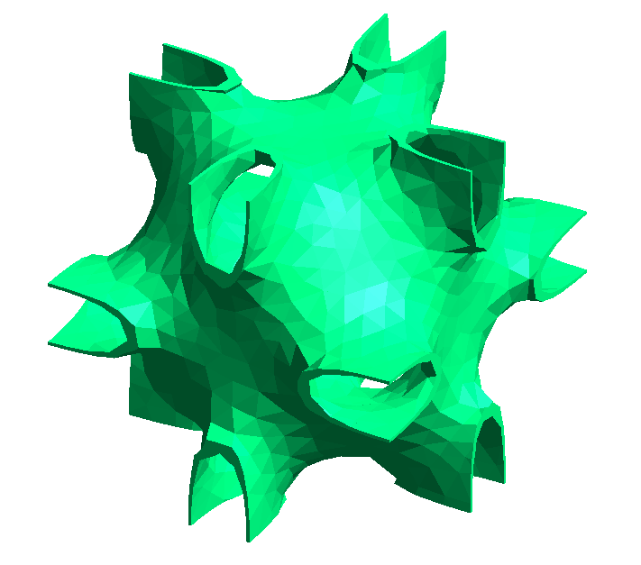
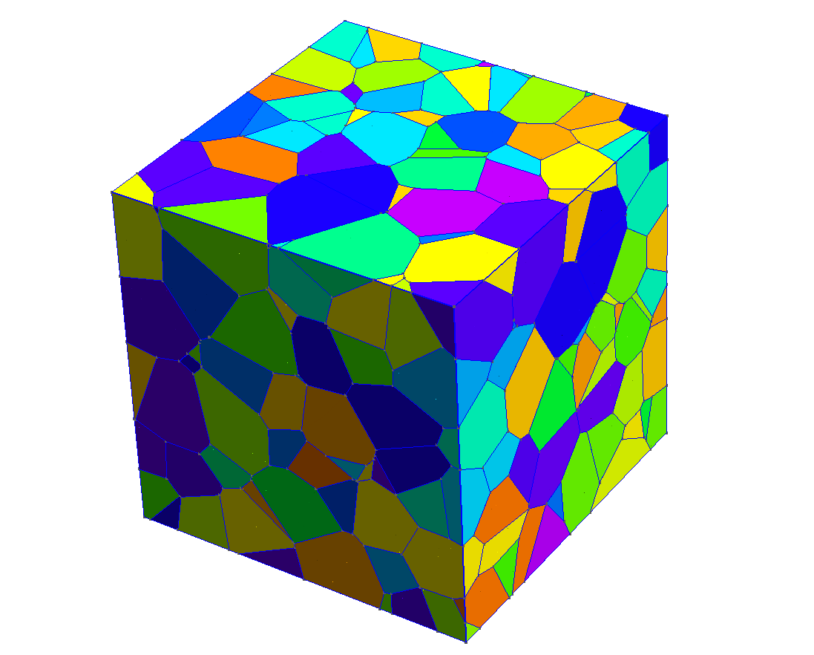
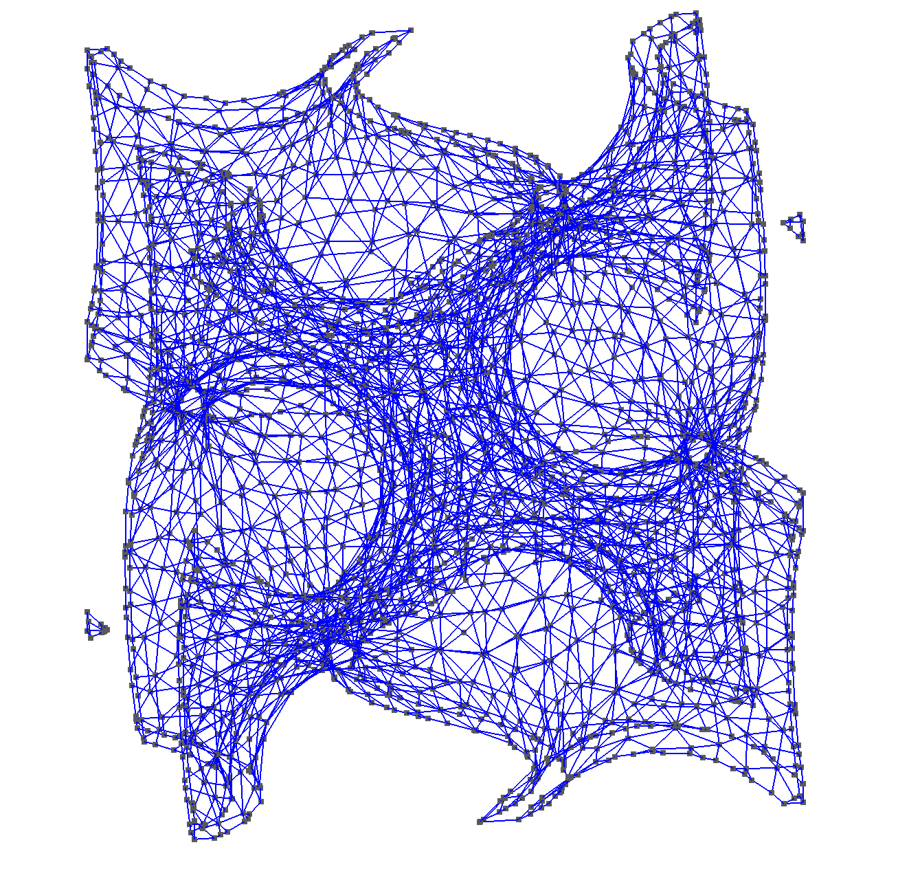

<div class="tpms-hero">
<div class="tpms-hero__text">
<h1>microgen</h1>
<p class="tpms-hero__tagline">Microstructure generation &amp; periodic meshing</p>
<p class="tpms-hero__lead">A Python library to build TPMS, lattices, Voronoi polycrystals and hybrid
architectures from implicit fields, then mesh them — conforming, graded or periodic — for finite element
analysis and 3D printing.</p>
<p class="tpms-hero__actions">
<a class="md-button md-button--primary" href="#install">Get started</a>
<a class="md-button" href="https://3mah.github.io/microgen-docs/">Documentation</a>
<a class="md-button" href="../examples/#microgen">Examples</a>
</p>
</div>
<div class="tpms-hero__visual">
<canvas class="tpms-hero__canvas" data-color="#ee7d30" aria-label="Wireframe mesh of a triply periodic minimal surface morphing between surface families"></canvas>
<span class="tpms-hero__label">Gyroid</span>
</div>
</div>

[](https://www.python.org/)
[](https://github.com/3MAH/microgen)
[](https://github.com/3MAH/microgen)
[](https://conda.anaconda.org/set3mah)
[](https://pypi.org/project/microgen/)
[](https://3mah.github.io/microgen-docs/)


Here are the main features:

* **TPMS**: gyroid, Schwarz, Schoen, Neovius, Fischer-Koch… as sheets or skeletons, graded in density, cell size or cell type, in Cartesian, cylindrical or spherical frames, and as infill of any mesh
* **Spinodoids**: random, anisotropic bicontinuous microstructures from Gaussian random fields
* **Lattice structures**: octet-truss, honeycomb, preset and custom (e.g. auxetic) strut lattices
* **Virtual composites**: periodic RVEs of spheres, short fibres, ellipsoids and other inclusions
* **Voronoi tessellation**: 3D polycrystals (using Neper), also combined with TPMS
* **Implicit workflow**: shapes as implicit fields, with boolean operations and blending
* **Mesh generation**: conforming and periodic meshes with Gmsh, level-set remeshing with MMG

<figure class="gallery gallery--2">
<a href="https://3mah.github.io/microgen-docs/examples/TPMS/infill_bunny.html"></a>
<a href="https://3mah.github.io/microgen-docs/examples/Spinodoids/spinodoid.html"></a>
<a href="https://3mah.github.io/microgen-docs/examples/TPMS/tpms_surfaces.html"></a>
<a href="https://3mah.github.io/microgen-docs/examples/Lattices/octet_truss.html"></a>
<figcaption>From the <a href="https://3mah.github.io/microgen-docs/examples/index.html">example gallery</a>: gyroid infill of a mesh, spinodoid, available TPMS families and a periodic octet-truss mesh.</figcaption>
</figure>

microgen is dedicated to parametric geometrical definition of structures applied to mechanical simulations. Triply periodic surfaces and volumes are easy to represent for FEM simulation or 3D printing. microgen's objective is to represent, with an easy-to-learn Python scripting approach, any CAD-compatible surface and volume and be able to easily perform parametric analysis.

Several geometrical operations are included (repetition, boolean, slicing, etc.). microgen relies on PyVista (Python VTK visualisation library) for implicit shapes and meshes, and optionally on OCP (Python bindings of Open CASCADE) for CAD. It facilitates the generation of meshes using GMSH, allowing periodic meshes if the geometry is periodic. It also wraps the [MMG remeshing software](https://www.mmgtools.org) developed at INRIA.

This software is compatible with [fedoo](https://3mah.github.io/fedoo-docs/stable/) for non-linear (geometrical and material) homogenization for mechanical, thermal and thermo-mechanical problems. It can also be utilised with other FEA solutions such as Abaqus, Ansys, Salome, FEniCS, Zebulon, etc.

## Install

=== "conda"

    ```bash
    conda install -c conda-forge microgen
    ```

=== "pip"

    ```bash
    pip install "microgen[cad]"
    ```

## Documentation

<div class="doc-links" markdown>
[:octicons-download-16: Installation](https://3mah.github.io/microgen-docs/Install.html){ .md-button }
[:octicons-rocket-16: Quick start](https://3mah.github.io/microgen-docs/quick_start.html){ .md-button }
[:octicons-image-16: Examples](https://3mah.github.io/microgen-docs/examples/index.html){ .md-button }
[:octicons-code-16: API reference](https://3mah.github.io/microgen-docs/modules.html){ .md-button }
[:octicons-history-16: Changelog](https://3mah.github.io/microgen-docs/changelog.html){ .md-button }
</div>

## Featured examples

--8<-- "examples_microgen.md"

[:octicons-image-16: All examples of the 3MAH stack](examples.md){ .md-button .md-button--primary }
[:octicons-arrow-left-16: Back to 3MAH](index.md){ .md-button }

## Research highlights

<figure class="gallery gallery--3">
<a href="/assets/images/about/neovius_sheet.png"></a>
<a href="/assets/images/about/voronoi500.png"></a>
<a href="/assets/images/about/gyroid_points.png"></a>
<figcaption>Main microstructures obtained using the microgen library: <code>Neovius TPMS</code>, <code>Voronoi tessellation of polycrystals</code>, and <code>Gyroid surfaces</code>.</figcaption>
</figure>
