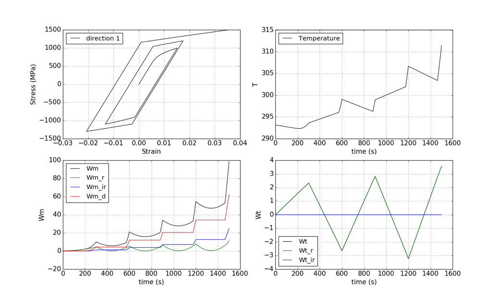
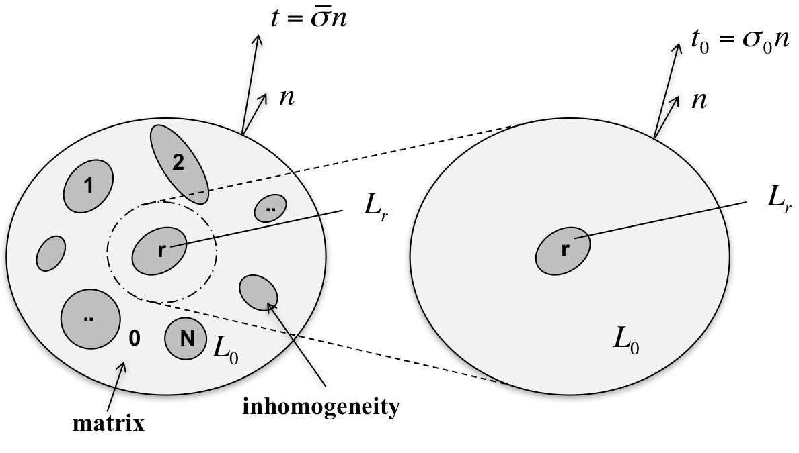
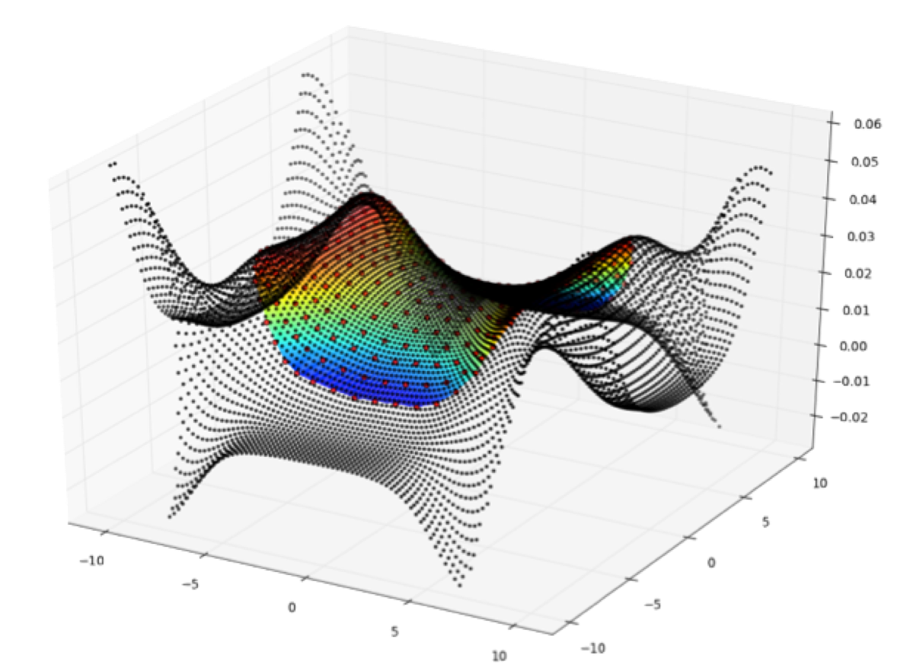

# simcoon — Constitutive Modeling & Micromechanics

<div class="feature feature--left">

<div class="feature__body"><p class="feature__excerpt">simcoon is a scientific library built to facilitate the analysis of mechanics of materials. It provides a C++ API with Python bindings, designed to help researchers implement modern material behavior models for Finite Element Analysis packages. Built on Armadillo and FTensor for high-performance tensor operations.</p>
<p><a class="md-button md-button--primary" href="https://3mah.github.io/simcoon-docs/">View Documentation</a></p></div>
</div>

Here are the main features:

* simcoon provides both a C++ and a Python API for flexibility and accessibility
* Built on the Armadillo linear algebra library and FTensor for advanced tensor operations, providing a balance between speed and ease of use
* Thermomechanical solver for material point analysis and composite effective property prediction
* Constitutive models for anisotropic elasticity, plasticity, viscoelasticity, and phase transformation
* Handles geometric non-linearities with multiple strain measures (Lagrangian, Eulerian, cumulative strains) and spin options (Jaumann, Green-Naghdi, logarithmic)
* Extensive libraries for continuum mechanics functions, homogenization techniques, and micromechanics schemes
* Built-in identification software using hybrid genetic-gradient algorithms
* Can be used as a standalone solver or coupled to FEA packages (Abaqus, Ansys, etc.)

## Install

=== "conda"

    ```bash
    conda install -c conda-forge -c set3mah simcoon
    ```

=== "pip"

    ```bash
    pip install simcoon
    ```

## Documentation

<div class="doc-links" markdown>
[:octicons-download-16: Installation](https://3mah.github.io/simcoon-docs/installation.html){ .md-button }
[:octicons-book-16: Material point simulation](https://3mah.github.io/simcoon-docs/simulation/index.html){ .md-button }
[:octicons-stack-16: Homogenization](https://3mah.github.io/simcoon-docs/homogenization/index.html){ .md-button }
[:octicons-image-16: Examples](https://3mah.github.io/simcoon-docs/examples/index.html){ .md-button }
[:octicons-code-16: C++ API reference](https://3mah.github.io/simcoon-docs/cpp_api/index.html){ .md-button }
</div>

## Featured examples

--8<-- "examples_simcoon.md"

[:octicons-image-16: All examples of the 3MAH stack](examples.md){ .md-button .md-button--primary }
[:octicons-arrow-left-16: Back to 3MAH](index.md){ .md-button }

## Research highlights

<figure class="gallery gallery--3">
<a href="/assets/images/about/coupled_cons_models.png"></a>
<a href="/assets/images/about/micromechanics.png"></a>
<a href="/assets/images/about/DIC_map.png"></a>
<figcaption>Main features of the simcoon library: <code>Constitutive models</code>, <code>Multi-scale models</code>, and <code>Identification and analyses</code>.</figcaption>
</figure>
