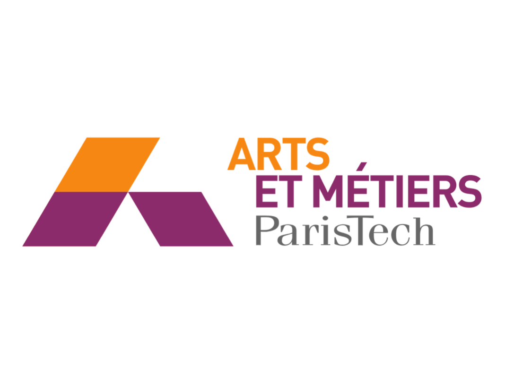
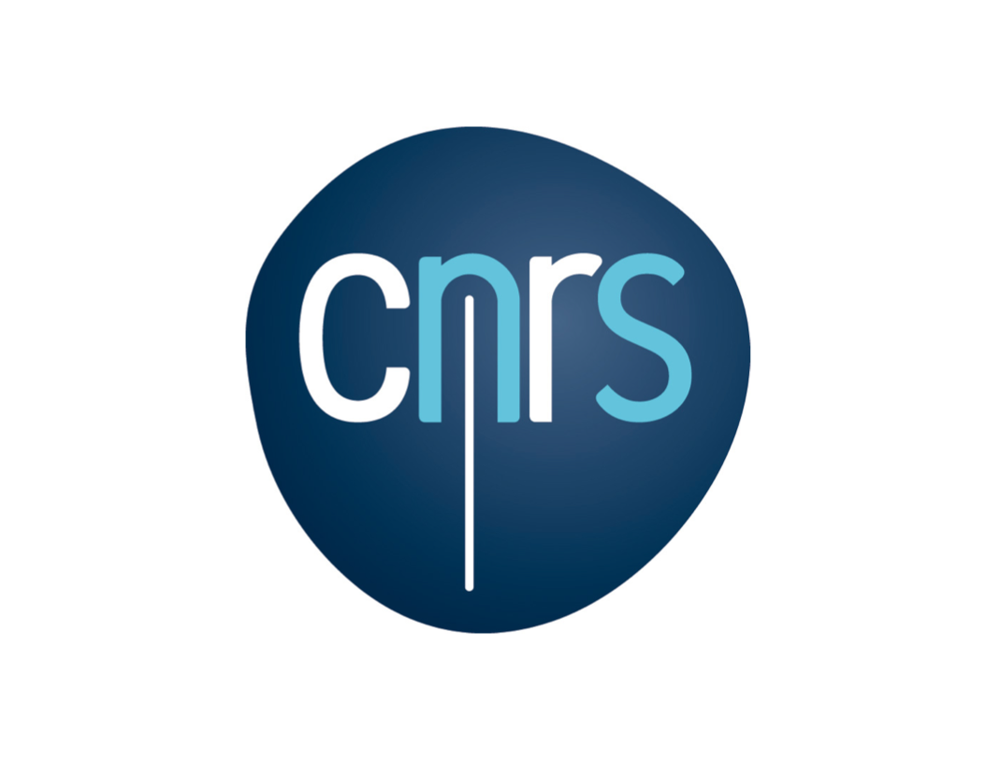

# Team & Collaborators

## Lead developers

simcoon, fedoo and microgen are mainly developed and maintained by the 3MAH Team, jointly at the **laboratoire TIMC** (Université Grenoble Alpes) and the **I2M laboratory** (Arts et Métiers, Bordeaux). All projects are released under the GNU General Public License: GPL, version 3.

| Name | Role | GitHub |
|------|------|--------|
| **Yves Chemisky** | Full Professor at Université Grenoble Alpes, laboratoire TIMC | [chemiskyy](https://github.com/chemiskyy) |
| **Etienne Prulière** | Associate Professor at Arts et Métiers, Bordeaux | [pruliere](https://github.com/pruliere) |
| **Kevin Marchais** | R&D Software Developer at HIVELIX | [kmarchais](https://github.com/kmarchais) |

## Institutions

The 3MAH tools are collaborative efforts from researchers around the world. The main development laboratories are the **TIMC** (Université Grenoble Alpes) and the **I2M** (Arts et Métiers, Bordeaux).

<figure class="gallery gallery--3">

<figcaption>Main academic partners that contribute to the development of the 3MAH tools: Université Grenoble Alpes, Arts et Métiers, and CNRS</figcaption>
</figure>

The [TIMC laboratory](https://www.timc.fr/) (Translational and Interdisciplinary Medicine in Grenoble) is a CNRS research unit (UMR 5525) at Université Grenoble Alpes. It brings together researchers from the fields of medicine, biology, computer science, mathematics and engineering to develop innovative approaches in health sciences and biomedical engineering. Within TIMC, the **BIOMECAMOT** team focuses on biomechanics, constitutive modeling of biological and engineering materials, and the development of computational tools for multiscale and multiphysics simulations. The 3MAH tools are actively developed within this team, bridging the gap between advanced material modeling and biomedical applications.

The [I2M laboratory](https://www.i2m.u-bordeaux.fr/) (Institut de Mécanique et d'Ingénierie) in Bordeaux gathers research efforts in mechanical engineering.
I2M is part within several projects connected to design the industry of the future, functional materials, sustainable housing or to prevent deterioration of famous historical sites as the cave of Lascaux. Such projects are supported by skills acquired and developed in the field of multiscale physical phenomena within heterogeneous media and systems, either using experimental approaches (from microscopy to process instrumentation), or the numerical tools (such as simcoon and fedoo, but you shall have a look at [Notus](https://notus-cfd.org/) in fluid mechanics, and [GranOO](https://www.granoo.org/) for 3D dynamic simulations based on the discrete element method).

Other institutions have participated or are using the 3MAH tools around the world:

* TU Bergakademie Freiberg: Top level School of Mines in Germany
* LEM3: Laboratory devoted to the study of Microstructures and Mechanics of Materials in Metz, France
* Texas A&M University: Top University in Texas, USA
